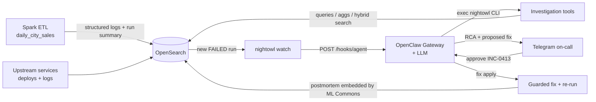

# 🦉 NightOwl: an Autonomous AI Engineer with OpenClaw + OpenSearch

> It's 2 AM. The Spark pipeline that feeds the morning city-ops dashboard just failed.
> Nobody is awake. **NightOwl is.**

NightOwl is an AI on-call engineer. When an Apache Spark pipeline fails it:

1. **Detects** the failure in OpenSearch and wakes an OpenClaw agent through the Gateway webhook (no human prompt).
2. **Investigates** like a senior SRE, using OpenSearch as its only source of truth:
   - the run timeline (structured Spark logs)
   - a schema diff against the last good run
   - "what changed?" (deploys, rollouts, config, DB maintenance)
   - WARN/ERROR logs from upstream services around the failure
   - hybrid (BM25 + neural) search over past postmortems, which is the team's memory
   - lineage, to see which downstream SLAs breach and in how many minutes
3. **Reports** a root-cause analysis with evidence on Telegram and **proposes** a fix.
4. **Waits for a human** to reply `approve INC-xxxx`, then applies a guarded config fix,
   re-runs Spark (green ✅), measures MTTR and **writes the postmortem back into OpenSearch**,
   so the next occurrence is recognised instantly.

Three real failure modes (the audience picks one live): **schema drift**, **bad upstream data**
and a **missing upstream partition**. There is also an optional **prompt-injection** trap hidden in the logs.



**OpenSearch features used:** structured log indexing, bool/range/terms queries, aggregations,
ML Commons (in-cluster `all-MiniLM-L6-v2`), ingest pipeline with `text_embedding`,
k-NN (`knn_vector`, HNSW), neural query, hybrid query + normalization search pipeline, Dashboards.

---

## Setup on Windows (WSL2). Budget about 60–90 minutes the first time.

Everything runs **inside WSL Ubuntu**. Keep the project in the Linux filesystem (`~/`), not `/mnt/c`.

### 1. WSL2 + Docker Desktop
In **PowerShell (Admin)**:
```powershell
wsl --install -d Ubuntu-24.04
```
Restart if asked, open Ubuntu, create your user. Install **Docker Desktop**, then in Docker Desktop:
*Settings → Resources → WSL integration → enable Ubuntu*. Give Docker at least **4 GB RAM**
(*Settings → Resources*).

Enable systemd in WSL (needed by the OpenClaw gateway service):
```bash
sudo tee /etc/wsl.conf >/dev/null <<'EOF'
[boot]
systemd=true
EOF
```
Then in PowerShell run `wsl --shutdown` and reopen Ubuntu.

### 2. System packages (Ubuntu)
```bash
sudo apt update && sudo apt install -y openjdk-17-jdk python3-venv python3-pip curl unzip
sudo sysctl -w vm.max_map_count=262144   # OpenSearch needs this
```

### 3. Project + Python env
```bash
cd ~ && unzip /mnt/c/Users/<you>/Downloads/nightowl.zip && cd nightowl
python3 -m venv .venv && source .venv/bin/activate
pip install -e .
cp .env.example .env
```

### 4. OpenSearch + Dashboards
```bash
docker compose up -d
curl -s localhost:9200 | head -5        # wait ~60s until JSON appears
nightowl setup                          # indices, ML model (downloads ~90MB once), seed data, baseline run
```
If the ML model fails to deploy, NightOwl falls back to BM25 automatically. To try again later, run
`nightowl setup --reset`. Dashboards: <http://localhost:5601>.

### 5. Try the pipeline without AI first
```bash
nightowl run                             # green
nightowl break schema_drift --run        # red: real Spark UNRESOLVED_COLUMN
nightowl timeline latest                 # what the agent will see
nightowl schema-diff latest
nightowl similar "column order_amount cannot be resolved"
nightowl reset                           # back to green
```

### 6. OpenClaw + LLM + Telegram
```bash
curl -fsSL https://openclaw.ai/install.sh | bash
openclaw onboard --install-daemon        # pick your LLM provider + API key
```
**Model:** use the strongest tool-calling model you have API access to. Don't use a small local model
for a live demo: investigation quality and speed depend on it.

**Telegram:** in Telegram, message **@BotFather** → `/newbot` → copy the token. Then:
```bash
openclaw channels add --channel telegram --token <bot-token>
openclaw channels status --probe
# send any message to your bot in Telegram, then:
openclaw pairing list telegram
openclaw pairing approve telegram <CODE>
```
Put your Telegram numeric user id in `.env` as `TELEGRAM_CHAT_ID`. You can find it in `openclaw logs --follow`
when you message the bot. Also put the bot token in `TELEGRAM_BOT_TOKEN` if you want the instant
"investigating…" ping.

**Webhook (lets OpenSearch wake the agent):** edit `~/.openclaw/openclaw.json` and add:
```json5
{
  hooks: {
    enabled: true,
    token: "<long-random-string>",   // generate: openssl rand -hex 24
    path: "/hooks",
    allowedAgentIds: ["main"],
  },
}
```
Put the same token in `.env` as `OPENCLAW_HOOK_TOKEN`, then:
```bash
openclaw config validate && openclaw gateway restart
```

**Install the skill:**
```bash
bash scripts/install_openclaw_skill.sh
```
Start a fresh chat with your bot (send `/new`) so it loads the skill.

If OpenClaw ever asks to approve an `exec` of `nightowl.sh`, approve it permanently:
`openclaw approvals pending` → `openclaw approvals resolve <id> allow-always`.

### 7. Check everything
```bash
nightowl doctor
```

### 8. First full rehearsal
Terminal 1: `nightowl watch`
Terminal 2: `nightowl break schema_drift --run`
Your phone should buzz, and after about 1–2 minutes the RCA arrives. Reply `approve INC-xxxx`.

See **DEMO_RUNBOOK.md** for the stage choreography, backups and Q&A prep.

---

## Command reference

| Who | Command | What it does |
|---|---|---|
| presenter | `setup [--reset] [--no-ml]` | indices, embedding model, pipelines, seed data, baseline run |
| presenter | `run` | run the Spark job now |
| presenter | `break <schema_drift\|bad_data\|missing_partition> [--run] [--with-injection]` | arm a realistic failure |
| presenter | `reset [--no-run]` | clean input + default config + green baseline run (memory is kept) |
| presenter | `deliver` | upstream retry finally lands the missing partition |
| presenter | `watch` | detect failed runs in OpenSearch → wake OpenClaw |
| presenter | `doctor` | check the whole setup |
| agent | `status`, `failures`, `timeline`, `schema-diff`, `changes`, `logs-around`, `search-logs`, `similar`, `impact` | read-only investigation (all OpenSearch queries) |
| agent | `incident open / pending / show` | record RCA + **proposed** fix |
| agent | `fix apply <INC> --approved-by <human>` | guarded config fix → re-run → postmortem into memory |

## Guardrails (worth a slide)
- The agent's only tool is one CLI. Investigation commands are read-only.
- Fixes are a **whitelist** (`add_column_alias`, `enable_quarantine`, `rerun_only`). The pipeline config
  changes; code never does. Column names are validated against the pipeline's contract.
- `fix apply` refuses without a named human approver, refuses closed incidents, and audits every step to `nightowl-audit`.
- Log text is treated as untrusted (the injection scenario tests this).
- Honest limitation: an approval check inside the CLI is a *speed bump*. The real security boundary is OpenClaw's
  exec policy (allowlist only this script) plus OS-level isolation. Say this out loud; senior engineers will respect it.

## Offline test (no OpenSearch needed)
```bash
python -m tests.test_end_to_end_offline
```
This runs all three scenarios end to end (real Spark) against an in-memory fake of OpenSearch.
